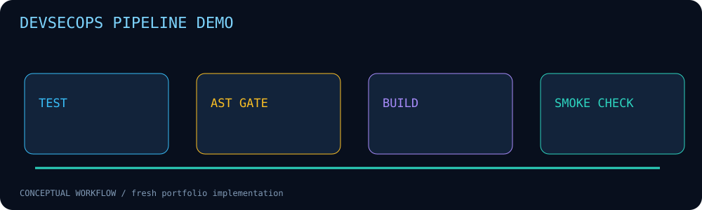

# DevSecOps Pipeline Demo



A minimal health service with a local AST gate, tests, source hashes and a GitHub Actions pipeline.

**Fresh portfolio implementation • Python 3.10+ • Standard library only**

## Run

```bash
python3 --version
python3 security_gate.py app.py
python3 -m unittest discover -s tests -v
```

## Implemented behavior

- Unit tests exercise the health endpoint and positive/negative policy cases.
- AST gate flags direct eval/exec calls and literal shell=True calls in explicitly listed files.
- Gate exits nonzero on findings; JSON includes SHA-256 hashes of checked source artifacts.
- CI uses read-only repository permissions, pinned action commits and a Python-version matrix.
- Docker recipe runs the service with a numeric non-root UID; container job builds and smoke-tests it.

## Scope and limitations

Educational gate only: no alias/dataflow resolution, taint analysis, dependency vulnerability database, image scanner or secret scanner. Dynamic shell expressions can be missed; attribute names may cause false positives. Python http.server is a demo service, not production serving. Docker base tag is mutable; approve and pin a digest before deployment. No deploy/publish credentials or production deployment. Local Python tests and gate are verified; Docker was unavailable locally and GitHub Actions has not yet run. Never describe the unrun container job as validated.

## Validation

5 unit tests passed locally on Python 3.12.14. Synthetic CLI examples were executed and results are included under `examples/`. No customer data, historical lab results or production effectiveness is claimed. CI configuration is supplied; remote CI status must be checked after publishing.

## Files

- `security_gate.py` — implementation and CLI.
- `tests/test_main.py` — regression and boundary tests.
- `examples/` — synthetic inputs and generated output.
- `assets/workflow.svg` — project-specific animation with reduced-motion support.
- `.github/workflows/ci.yml` — pinned-action CI.

## Safe operation

Use inputs and hosts you own or are authorized to assess. Review reports before publication; real files, headers and logs can contain sensitive information. These tools do not establish that a system is secure or compromised.

## Reference

https://docs.github.com/en/actions/reference/security/secure-use
