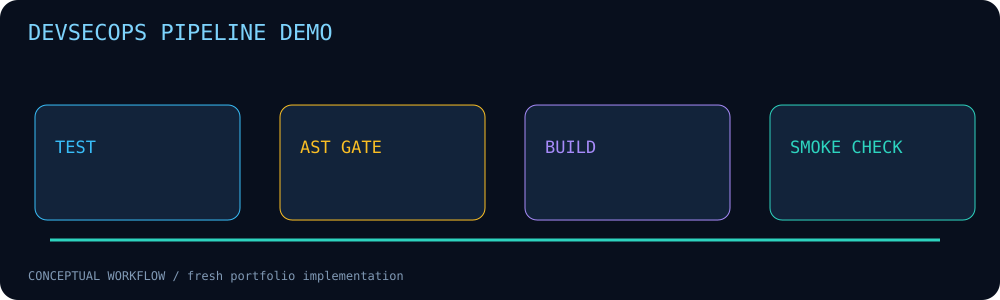

# DevSecOps Pipeline Demo

[](https://github.com/FAHAD-s3do/devsecops-pipeline-demo/actions/runs/40623263128) · [Latest successful main-branch run](https://github.com/FAHAD-s3do/devsecops-pipeline-demo/actions/runs/40623263128)



A minimal health service with a local AST gate, tests, source hashes and a GitHub Actions pipeline.

**Fresh portfolio implementation • Python 3.10+ • Standard library only**

## Run

```bash
python3 --version
python3 security_gate.py app.py
python3 -m unittest discover -s tests -v
```

## Implemented behavior

- Unit tests exercise the health endpoint and positive/negative policy cases.
- AST gate flags direct eval/exec calls and truthy constant `shell` arguments (such as `shell=True`, `shell=1`, or a non-empty string) in explicitly listed files.
- Gate exits nonzero on findings; JSON includes SHA-256 hashes of checked source artifacts.
- Parses Python source bytes using Python's encoding-cookie and UTF-8 BOM rules, while hashing the original bytes. Valid non-UTF-8 source is no longer rejected before inspection.
- CI uses read-only repository permissions, pinned action commits and a Python-version matrix.
- Docker recipe runs the service with a numeric non-root UID; container job builds and smoke-tests it.

## Scope and limitations

Educational gate only: no alias/dataflow resolution, taint analysis, dependency vulnerability database, image scanner or secret scanner. Dynamic shell expressions can be missed; attribute names may cause false positives. Python http.server is a demo service, not production serving. Docker base tag is mutable; approve and pin a digest before deployment. No deploy/publish credentials or production deployment. Local Python tests and gate are verified. Docker was unavailable locally; the GitHub Actions container build and non-root smoke test passed after publication.

## Validation

14 unit tests passed locally on Python 3.12.14, including truthy/falsy shell constants, static-only inspection, declared Latin-1 encoding, UTF-8 BOM, invalid encodings, exact-byte hashes, and CLI exit codes. Synthetic CLI examples were executed and results are included under `examples/`. No customer data, historical lab results or production effectiveness is claimed. The initial GitHub Actions tests on Python 3.10 and 3.12, static gate, and container job [passed](https://github.com/FAHAD-s3do/devsecops-pipeline-demo/actions/runs/38247548910); check current Actions results for subsequent changes.

The gate exits 0 for inspected files without findings, 1 for policy findings, and
2 for read/parse/encoding errors. Errors produce a diagnostic on stderr rather
than a partial JSON report. Encoding support does not execute source files or
broaden the gate's limited AST analysis.

The `SHELL_TRUE` rule uses the truth value of AST constants rather than requiring
the exact boolean `True`, matching how subprocess enables shell execution. Falsy
constants such as `0`, `False`, and empty strings are not flagged. Variables,
container literals, unary operators and other expressions remain outside this
rule; no constant-expression evaluation or alias resolution is attempted.

## Files

- `security_gate.py` — implementation and CLI.
- `tests/test_main.py` — regression and boundary tests.
- `examples/` — synthetic inputs and generated output.
- `assets/workflow.svg` — project-specific animation with reduced-motion support.
- `.github/workflows/ci.yml` — pinned-action CI.

## Safe operation

Use inputs and hosts you own or are authorized to assess. Review reports before publication; real files, headers and logs can contain sensitive information. These tools do not establish that a system is secure or compromised.

## Reference

https://docs.github.com/en/actions/reference/security/secure-use

