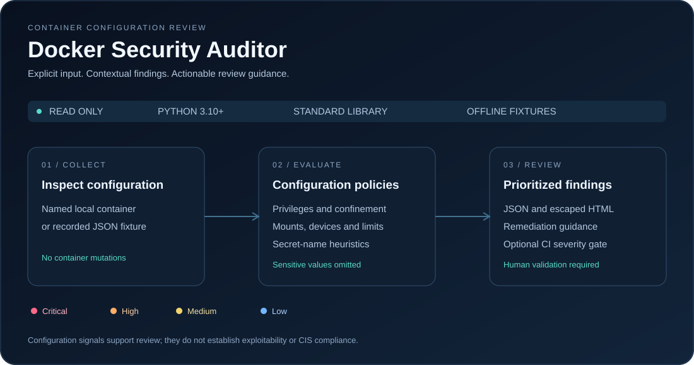

# Docker Security Auditor

Read-only Docker configuration reviews with severity-ranked findings, remediation guidance, and CI thresholds.



**Python 3.10+ · Standard library · JSON / HTML · Explicit local inspection**

## Quick start

Run from this directory:

```bash
# Review a recorded fixture without Docker access
python auditor.py --fixture examples/inspect.json

# Review one explicitly named local container
python auditor.py --container my-container

# Write an HTML report; choose a new filename to preserve previous reports
python auditor.py --container my-container --format html > report.html

# Fail CI on high or critical findings
python auditor.py --fixture examples/inspect.json --fail-on high
```

Shell redirection can overwrite an existing report. Live mode requires Docker CLI access;
offline mode requires only Python. Neither mode changes containers.

## Review coverage

| Area | Configuration signals |
| --- | --- |
| Privileges | Privileged mode, configured root user, sensitive added capabilities |
| Isolation | Host network/PID namespaces, explicitly disabled security profiles |
| Host access | Docker sockets, sensitive Linux bind mounts, mapped devices |
| Resource controls | Memory/PID limits and writable root filesystem |
| Secret handling | Environment-variable name heuristics; names and values omitted |
| Delivery | JSON schema version 2, escaped HTML, severity counts, remediation |

## CI behavior

| Exit code | Meaning |
| --- | --- |
| 0 | Collection succeeded; configured finding threshold was not met |
| 1 | Findings meet `--fail-on`, or findings exist with `--fail-on-findings` |
| 2 | Invalid input or collection failure |

Without a finding flag, collection success returns 0 even when findings exist.
`--fail-on high` includes critical findings. This is a configuration review gate,
not a security certification.

## Validation

```bash
python -m unittest discover -s tests -v
```

The project has 17 tests covering rule boundaries, malformed input, output
escaping, value omission, severity counts and CLI exit behavior. The dedicated
Docker Auditor Tests workflow runs on Python 3.10 and 3.12. Live Docker collection
was not validated locally; inspect fixture tests do not establish runtime protection.

## Interpretation and limits

An empty configured user requests review; it does not prove the running process
is root. Parent cgroups can impose limits absent from container configuration.
Absent security options do not prove that profiles are disabled: daemon defaults
and platform behavior need verification. Secret-name checks can miss secrets
and produce false positives.

Renamed sockets, indirect access, effective runtime capabilities, image CVEs,
daemon configuration, effective seccomp policy and full CIS compliance are outside
scope. Sensitive binds cover selected Linux paths; alternate data roots need
manual assessment. Docker access can grant extensive host control.

Environment variables and mount paths are omitted from findings. Container names
can still identify internal workloads; review reports before sharing.
